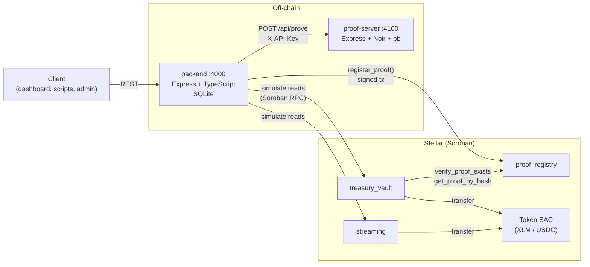
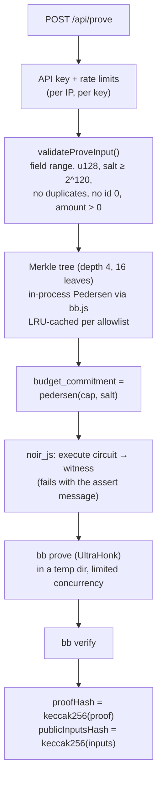
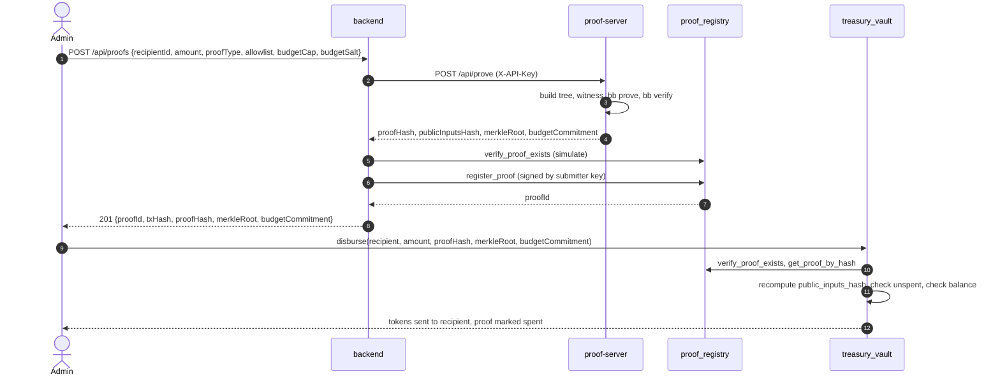
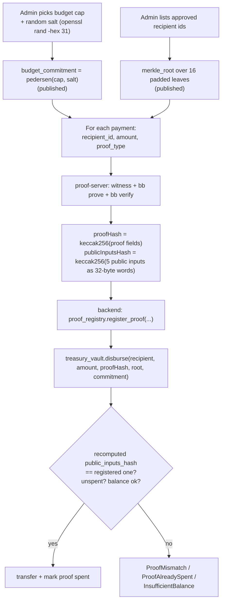
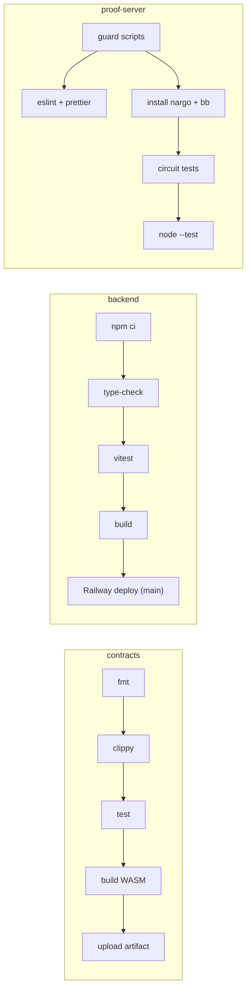

# Veil: build and architecture

Private treasury management on Stellar: Soroban contracts, an API backend, and a Noir zero-knowledge proof
server, in one repo. This document covers how it is built and how it fits together. It can be imported
straight into [HackMD](https://hackmd.io); diagrams use Mermaid, which HackMD and GitHub both render.

## Contents

1. [Overview](#overview)
2. [Architecture](#1-system-overview) — components, contracts, proof server, backend, end-to-end flow, security
3. [Zero-knowledge proof flow](#zero-knowledge-proof-flow)
4. [Build](#7-build)
5. [API reference](#8-api-reference)
6. [Deployment and configuration](#9-deployment-and-configuration)

## Overview

Veil is private treasury management on Stellar. An organisation keeps funds in a Soroban vault, streams
payroll per second, and pays out grants. Every payout from the vault must be backed by a zero-knowledge
proof that the recipient is on an approved list and the amount is within a pre-committed budget. The proof
reveals neither the rest of the list nor the budget. Proofs are generated and verified off-chain by the
proof server, anchored on-chain in a registry, and checked again by the vault before it pays.

## Repository map

```
Veil/
├── contracts/        Rust · Soroban smart contracts (treasury_vault, streaming, proof_registry)
├── backend/          TypeScript · Express REST API, SQLite, Soroban RPC client
├── proof-server/     JavaScript · Noir circuits + Barretenberg prover service
├── hackmd/           this document
├── docker-compose.yml  proof server + backend, wired together
└── .github/          per-package CI, Dependabot, CODEOWNERS
```

## 1. System overview

Veil has three parts. Each lives in its own folder, builds on its own, and has its own CI workflow.



| Component | Role | Holds state? |
|-----------|------|--------------|
| **contracts** | Custody of funds, payment streams, the public proof record. The source of truth. | Yes, on-chain |
| **backend** | Public read API over the contracts, campaign metadata, and the only signer of `register_proof()` | SQLite (campaigns only) |
| **proof-server** | Turns payment inputs into a verified zero-knowledge proof and its hashes | No (in-memory caches only) |

## 2. On-chain layer: `contracts/`

A Cargo workspace with three Soroban contracts (soroban-sdk 22, Rust 1.96, built for `wasm32v1-none`).

### treasury_vault: custody

- `deposit(depositor, amount)`: anyone deposits the vault's token. Tracks `total_raised`.
- `disburse(recipient, amount, proof_hash, merkle_root, budget_commitment)`: admin-only. Pays out **only** if:
  1. `proof_hash` is registered in `proof_registry`,
  2. it hasn't been spent before (each proof pays once),
  3. the vault recomputes `keccak256(merkle_root ‖ budget_commitment ‖ recipient_field ‖ amount ‖ proof_type_id)`
     and it equals the registered `public_inputs_hash`, so the proof is for exactly this payment,
  4. the vault's balance covers `amount`.
- Reads: `get_balance`, `get_stats`, `is_proof_spent`, `get_token`, `get_proof_registry`.

### streaming: payroll per second

- `create_stream(recipient, flow_rate_per_second, end_time)`: admin-only. **Reserves** the full
  `rate × duration` from the uncommitted balance, so streams can never be over-promised.
- `withdraw(stream_id)`: recipient claims what has accrued. `toggle_stream` pauses or resumes, and
  pausing snapshots the accrued amount.
- `close_stream`: admin settles an ended stream to its recipient. `reclaim` withdraws only unreserved funds.
- Reads: `get_accumulated` (live claimable), `get_stream(s)`, `get_committed`, `get_available`, `get_token`.

### proof_registry: public proof record

- `register_proof(submitter, proof_hash, public_inputs_hash, proof_type)`: admin-only, rejects duplicates and
  unknown types (`payroll`, `operational`, `relief`).
- Reads: `verify_proof_exists`, `get_proof_by_hash`, `get_proof(s)`, `get_proof_count`.

### Shared design rules

| Rule | Why |
|------|-----|
| Admin set in `__constructor` | No uninitialised window in which someone else could claim the contract |
| Two-step admin transfer (`propose_admin` → `accept_admin`) | A mistyped address can't take over |
| Typed `#[contracterror]` enums | Clients get `Error(Contract, #n)` instead of opaque traps |
| Checked arithmetic everywhere | Overflow is an error, not a wrap |
| Paginated reads (`get_*(start, limit)`, max 50) | Read cost stays bounded as data grows |
| TTL extension on every write | Entries don't get archived: instance 30 days, records 90 days, streams until `end_time` + 30 days, proofs to the network max |
| Events on every state change | Indexers and the backend's history endpoint can follow everything |

## 3. Proof layer: `proof-server/`

A Node 22 / Express service wrapping two Noir circuits and the Barretenberg prover.



| Module | Job |
|--------|-----|
| `server.js` | HTTP, request IDs, structured logs, graceful shutdown |
| `auth.js` | Constant-time API key check |
| `proveService.js` | Input validation and the end-to-end prove flow |
| `merkle.js` / `pedersen.js` | Allowlist tree with the circuit's exact Pedersen hash |
| `prover.js` | Circuit compile (once), witness, `bb prove` / `bb verify` |
| `hash.js` | keccak anchor hashes, `addressToField` |
| `limiter.js` | Concurrency cap for proofs |

## 4. API layer: `backend/`

A Node 22 / Express / TypeScript service.

| Layer | Files | Job |
|-------|-------|-----|
| Routes | `routes/treasury, streams, proofs, campaigns` | HTTP endpoints, zod validation (`schemas.ts`) |
| Middleware | `auth, rateLimit, validate, errorHandler` | Admin bearer token, read/write rate limits, consistent JSON errors |
| Services | `stellar.ts` | Soroban RPC: simulated reads, paginated reads with legacy fallback, event history, `register_proof` submission |
| | `proofServer.ts` | Client for the proof server (timeouts, status mapping, response validation) |
| | `db.ts`, `backup.ts` | SQLite (WAL) for campaign metadata, online snapshots with retention |
| Config | `config/index.ts` | Every setting validated at startup |

Key behaviours:

- **Reads cost nothing.** Contract reads are simulated transactions from a dummy source account, with no
  signing and no fees.
- **One signer, serialized.** Proof anchoring is queued in-process so concurrent requests never collide on
  the submitter account's sequence number.
- **Legacy-aware.** Contracts deployed before pagination are detected once and read with the old getters.

## 5. End-to-end: paying a recipient



## 6. Trust and security boundaries

| Boundary | Protection |
|----------|-----------|
| Internet → backend | CORS allowlist, per-IP read and write rate limits, zod validation, 100kb body limit, helmet headers |
| Admin routes | `Authorization: Bearer ADMIN_API_KEY`, compared as SHA-256 digests in constant time. Disabled (503) if unset. |
| backend → proof server | `X-API-Key`; the proof server refuses everything without configured keys |
| backend → chain | Only `PROOF_SUBMITTER_SECRET` can register proofs, and it must be the registry admin (checked at startup) |
| Payouts | The vault re-derives the public inputs hash and refuses mismatched, unregistered or already-spent proofs |
| Secrets | `budgetSalt` is never returned or logged; logs redact caps, salts and keys |
| Supply chain | Digest-pinned base images, checksum-verified toolchains, SHA-pinned Actions, pinned Rust, Dependabot |

**Known trust assumption:** Soroban has no on-chain verifier for Noir proofs, so the chain trusts whoever
holds the registry admin key to register only hashes of proofs that passed `bb verify`. See
[zk-proof-flow.md](#trust-model).

## Zero-knowledge proof flow

### What gets proved

The `payroll_compliance` Noir circuit (`proof-server/circuits/payroll_compliance/src/main.nr`) proves three things
at once:

1. **Membership:** `recipient_id` is a leaf of the allowlist Merkle tree whose root is `merkle_root`.
2. **Budget:** `amount ≤ budget_cap`, where the admin committed in advance to
   `budget_commitment = pedersen_hash([budget_cap, budget_salt])`.
3. **Category:** `proof_type_id ∈ {0 payroll, 1 operational, 2 relief}`.

### Public vs private inputs

| Input | Visibility | Why |
|-------|-----------|-----|
| `merkle_root` | public | Commits to the allowlist without listing it |
| `budget_commitment` | public | Commits to the cap without revealing it |
| `recipient_id` | public | Already visible in the on-chain transfer |
| `amount` | public | Already visible in the on-chain transfer |
| `proof_type_id` | public | The registry stores it |
| `merkle_path`, `merkle_index` | **private** | Would reveal the other allowlist entries |
| `budget_cap` | **private** | The secret being protected |
| `budget_salt` | **private** | Hides the cap inside the commitment |

**What an observer learns:** this recipient was approved and this amount was within budget.
**What they don't learn:** who else is approved, or what the budget is.

### Circuit details

- **Tree:** fixed depth 4, so 16 leaves. Unused slots are padded with id `0`, which is why `0` can never be a recipient.
- **Leaf domain separation:** leaf = `pedersen([1, recipient_id])`, node = `pedersen([left, right])`, so a leaf
  can never be mistaken for an internal node.
- **Range check:** `amount` and `budget_cap` are both constrained to 128 bits before the `u128` comparison,
  so a huge field element can't wrap around and pass as a small number.
- **Proof system:** UltraHonk via Barretenberg (`bb`), pinned to `nargo 1.0.0-beta.22` / `bb 5.0.0-nightly.20260522`.

### The flow, step by step



### Hash compatibility (three implementations, one answer)

The same values are computed in three places. They must agree byte for byte, and tests pin them together:

| Value | proof-server (JS) | treasury_vault (Rust) | Test |
|-------|-------------------|----------------------|------|
| `recipient_id` from a `G…` address | `addressToField()`: keccak256(strkey) mod p | `recipient_field()` | `hashing_matches_proof_server` |
| `public_inputs_hash` | `hashPublicInputs()` | `public_inputs_hash()` | test vectors in `treasury_vault` |
| Pedersen (tree, commitment) | `@aztec/bb.js` in-process | the circuit itself | `pedersen.test.js` against the `hash_util` circuit |

### Rules enforced before proving

Checked in the backend schema and again in the proof server:

- every number is a non-negative integer below the BN254 field modulus (never silently reduced)
- `amount` and `budgetCap` are below 2^128, and `amount > 0` (the vault rejects zero)
- `budgetSalt` is required and at least 2^120, since a guessable salt would let anyone brute-force the cap
- the allowlist has 1–16 entries, no duplicates (compared by value), and no `0`

### Trust model

| Guarantee | Enforced by |
|-----------|-------------|
| A proof is cryptographically valid | `bb verify` in the proof server |
| A registered proof matches a specific payment | Vault recomputes `public_inputs_hash` |
| A proof pays out at most once | Vault's `SpentProof` record |
| Only real proofs get registered | **Trust in the registry admin key** (the backend's submitter) |

Soroban has no precompile for verifying Noir/UltraHonk proofs, so verification happens off-chain and only
a hash goes on-chain. Removing the last trust assumption would need an on-chain verifier contract or a
multi-party attestation scheme.

## 7. Build

### Toolchains

| Tool | Version | Used by | Pinned in |
|------|---------|---------|-----------|
| Rust | `1.96.0` + `wasm32v1-none`, clippy, rustfmt | contracts | `contracts/rust-toolchain.toml` |
| soroban-sdk | `22` | contracts | `contracts/Cargo.toml` |
| Node.js | `22` LTS | backend, proof-server | `.nvmrc`, `engines` |
| `nargo` (Noir) | `1.0.0-beta.22` | proof-server | CI, Dockerfile |
| `bb` (Barretenberg) | `5.0.0-nightly.20260522` | proof-server | CI, Dockerfile |
| `noir_js` / `bb.js` | exactly match `nargo` / `bb` | proof-server | `package.json` (Dependabot ignores them) |

Upgrade `nargo`, `bb`, `noir_js` and `bb.js` together in one change.

### Contracts

```bash
cd contracts
cargo fmt --all --check
cargo clippy --workspace --all-targets -- -D warnings
cargo test --workspace
cargo build --target wasm32v1-none --release   # → target/wasm32v1-none/release/*.wasm (12–23 KB each)
```

Release profile: `opt-level = "z"`, LTO, one codegen unit, `panic = "abort"`, overflow checks on.
Build for `wasm32v1-none`: from Rust 1.82, `wasm32-unknown-unknown` enables WASM features Soroban rejects.

### Backend

```bash
cd backend
npm ci
npm run lint    # tsc --noEmit
npm test        # vitest (RPC and proof server mocked)
npm run build   # → dist/
npm start       # or: npm run dev (hot reload)
```

### Proof server

```bash
cd proof-server
npm ci
npm run lint    # eslint + prettier
(cd circuits/payroll_compliance && nargo compile && nargo test)
npm test        # real proofs, needs nargo + bb installed
npm start
```

### Docker

| Image | Highlights |
|-------|-----------|
| `proof-server/Dockerfile` | checksum-verified `nargo`/`bb`, circuit compiled at build time, non-root, healthcheck, `linux/amd64` |
| `backend/Dockerfile` | compile → prod deps → runtime, non-root, SQLite on a `/data` volume, healthcheck |

Both use the same digest-pinned `node:22-bookworm-slim` base.

```bash
export PROOF_KEY="$(openssl rand -hex 32)"
docker compose up --build    # backend :4000 + proof-server :4100, wired together
```

### CI (GitHub Actions)

Each package has its own workflow, which runs only when its folder changes.



- read-only token, actions pinned to commit SHAs, Rust pinned
- older PR runs are cancelled when a new commit arrives; `main` runs are never cancelled
- Dependabot: weekly, minor and patch updates grouped (npm, Cargo, Docker, Actions)
- proof-server guard scripts reject over-long or whitespace-padded lines and obfuscated JS patterns

## 8. API reference

### Backend (`:4000`)

| Method | Path | Notes |
|--------|------|-------|
| `GET` | `/health` | status + network |
| `GET` | `/api/treasury/:id/balance` | `id` = contract or `default`; returns `asset` read from chain |
| `GET` | `/api/treasury/:id/stats` | balance, total raised, total disbursed |
| `GET` | `/api/treasury/:id/transactions?limit&cursor` | event history; pass `nextCursor` for the next page |
| `GET` | `/api/streams?start&limit` · `/api/streams/:id` · `/api/streams/:id/claimable` | |
| `GET` | `/api/proofs?start&limit` · `/api/proofs/:id` | |
| `POST` | `/api/proofs` | **admin**: prove + anchor on-chain |
| `GET` / `POST` | `/api/campaigns?start&limit` · `/api/campaigns/:id` | create is **admin** |

Admin routes need `Authorization: Bearer $ADMIN_API_KEY`. Errors are always `{ "error": "...", "details"? }`:
400 invalid input, 401 auth, 404 not found, 409 already exists, 422 circuit rejected, 429 rate limited,
502 RPC/proof server failed, 503 not configured, 504 proof server timeout.

### Proof server (`:4100`)

| Method | Path | Notes |
|--------|------|-------|
| `GET` | `/health` | proof types, max allowlist size |
| `POST` | `/api/prove` | needs `X-API-Key`; returns proof hashes, root, commitment (never the salt) |
| `POST` | `/api/address-to-field` | Stellar `G…` address → `recipientId` |

## 9. Deployment and configuration

### Deploy the contracts

```bash
stellar keys generate admin --fund --network testnet
ADMIN_ACCOUNT=admin ./contracts/scripts/deploy-testnet.sh
```

The script checks the token, builds, deploys all three contracts (each constructor sets the admin in the
same transaction), points the vault at the registry, verifies everything, and prints the IDs.
Current testnet deployment:

| Contract | ID |
|----------|----|
| treasury_vault | `CAUWJPC73YLQMSV6X4QPLUVS2UZFE2PMRIQSSCDN62DNN6J76Y5RETIG` |
| streaming | `CDU7ZIVQ3UC4K3DHV3NMQGW5UMSYFCKCC6YJKHT4YLNEZJRWL6THE6WQ` |
| proof_registry | `CBDLHQQPKC5524CFWPD4HMPTZGWBYQNW3IKGAFH6IAYBU3F2F6AO2332` |

To let the backend anchor proofs, make its submitter key the registry admin: `propose_admin` from the
current admin, then `accept_admin` from the submitter.

### Key settings

| Service | Setting | Purpose |
|---------|---------|---------|
| backend | `TREASURY_VAULT_CONTRACT_ID`, `STREAMING_CONTRACT_ID`, `PROOF_REGISTRY_CONTRACT_ID` | contracts to read |
| backend | `STELLAR_NETWORK`, `STELLAR_RPC_URL` | `testnet` or `mainnet` |
| backend | `ADMIN_API_KEY` | enables admin routes |
| backend | `PROOF_SERVER_URL`, `PROOF_SERVER_API_KEY` | how to reach the proof server |
| backend | `PROOF_SUBMITTER_SECRET` | signs `register_proof` (must be the registry admin) |
| backend | `CORS_ORIGINS`, `TRUST_PROXY` | required in production / behind a proxy |
| backend | `READ_RATE_LIMIT_MAX`, `WRITE_RATE_LIMIT_*` | rate limits |
| backend | `DB_PATH`, `DB_BACKUP_DIR`, `DB_BACKUP_INTERVAL_MINUTES`, `DB_BACKUP_KEEP` | SQLite and snapshots |
| proof-server | `PROVE_API_KEYS` | accepted keys (empty = refuses all) |
| proof-server | `MAX_CONCURRENT_PROOFS`, `SUBPROCESS_TIMEOUT_MS`, `PROVE_RATE_*` | load limits |
| proof-server | `NARGO_BIN`, `BB_BIN`, `TRUST_PROXY_HOPS`, `LOG_LEVEL` | toolchain paths, proxy, logging |

Full lists: `backend/.env.example` and `proof-server/.env.example`. Every numeric setting is validated at
startup, so a typo stops the service with a clear message instead of running misconfigured.

### Operations

- **Shutdown:** both services finish in-flight requests on SIGTERM (proofs can take tens of seconds).
- **Backups:** set `DB_BACKUP_DIR` (on separate storage) for periodic online SQLite snapshots.
- **Scaling:** proof anchoring is serialized per backend process. Run several replicas only with separate submitter keys.
- **Logs:** proof server logs JSON lines (pino) with request IDs; secrets are redacted.
